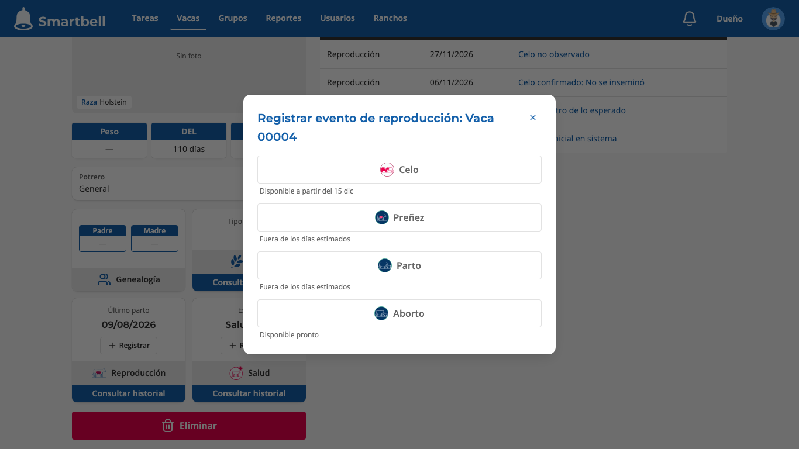

# Event forms: the launcher and the wizard shell

Every event-flow card (heat, pregnancy check, calving, abortion, health, diet) builds on the
pieces here, so each flow only draws its own steps.

| Piece               | What it does                                                                                                                                                                   |
| ------------------- | ------------------------------------------------------------------------------------------------------------------------------------------------------------------------------ |
| `EventLauncher.tsx` | The entries of one profile card (Reproducción or Salud), as a bottom sheet on phones and a modal on the web. Also `EventLauncherProvider`, mounted in the app shell.           |
| `EventWizard.tsx`   | The shell a flow runs in: a full-screen page on phones (<960px), a 534px modal on the web (≥960px). Owns the title, the "¿Descartar los cambios?" guard and the save.          |
| `useRecordEvent.ts` | The POST, the confirmation snackbar (event-flows 1.11, on phones too), the refresh of the animal, the lists and the potreros, and the "Falla de conexión" snackbar on failure. |
| `eventTypes.ts`     | Which entries each card offers and why one is disabled. Pure, unit-tested.                                                                                                     |
| `flows.tsx`         | The registry: one `EventFlow` per event kind.                                                                                                                                  |

## Rules

- **Who gets what.** Registrar shows on the Reproducción and Salud cards of an active animal
  when the user has `EVENTS_RECORD`. Reproduction entries are for females; a bull gets the
  Salud card's entries only; a semen-only bull and a removed animal get none.
- **Windows.** Celo, Preñez and Parto are enabled only while today is inside the cow's
  `projection.next_heat`, `pregnancy_check` or `calving` window ("está dentro de los días
  estimados"). Otherwise the entry says when it opens ("Disponible a partir del 3 dic"), that
  it closed, or that she is outside the estimated days. Aborto has no window.
- **Not built yet.** A kind with no registered flow says "Disponible pronto". The window
  reason wins over it, since it stays true once the flow lands.
- **Leaving.** With data entered, closing (×, Escape, a flow's Regresar) or leaving the page
  (a link, the phone's back gesture) asks first. Without data it just closes. Changing page
  closes any open launcher or form.
- **Potrero changes** stay on the profile's Potrero fact (Cambiar); they are not in the launcher.

## Adding a flow

1. Build the steps in `features/events/<kind>/`, as a component taking `EventFlowProps`.
   Use `ui/Wizard` for multi-step forms and one question per step for decision trees.
2. Call `setDirty(true)` as soon as the user enters something, and `record(body)` with the
   `EventCreate` body to save. Do not show snackbars or close yourself: the shell does both.
3. Register it in `EVENT_FLOWS` (`flows.tsx`) with its title key. The launcher entry turns on.

## From a task

`useEventLauncher().openEvent(animalId, kind, taskId?)` opens a flow directly and resolves
`true` once the event is recorded, so an automatic task can close itself, and `false` if the
user backed out. With a `taskId` the snackbar names the animal ("Vaca 00001: celo
registrado"), since no profile is behind it. The tasks screen does not exist yet:
`tasks-home` wires its automatic tasks to this later. `events.test.tsx` covers it with a
stand-in task.

## The heat prompt

The only flow so far is the heat task's prompt (v4-onboarding-dashboard-tasks §1.12):
"No entró" records `HEAT` with outcome `NOT_OBSERVED`. "Sí, confirmar" is disabled until the
`heat-flow` card adds the decision tree behind it.
