# Design inventory: 2019 web app (Inicio, Historial, Reportes)

Source: the 2019 Smartbell web app (Vue 2 + Vuetify + Firebase Realtime Database), rebuilt from the public source maps of smartbell.solutions. It lives **outside the repo**, on the founder's machine:

`/Users/juan/Documents/Inversiones/Smartbell/Accelerator Pro /Code - backup/smartbel solutions -2019/smartbell-solutions-2019`

(the space before `/Code` is part of the path). Paths below are relative to its `src/`. Read on 2026-11-27.

**Reference only.** No 2019 code is ported, no config is copied (`src/firebase.js` holds keys for another Firebase project and must never enter this repo), and no 2019 data is imported. These screens are the ancestors of the v3 designs in `alerts-dashboard-reports.md` and the v4 page in `v4-reports.md`. Where they disagree, the newer design and the founder decisions in `docs/roadmap/dashboard.md` win.

Verdicts used below:
- **covered**: a spec or inventory row already has it (cited).
- **gap**: in no spec yet.
- **drop**: not wanted, with the reason.

History and Reportes are **static mockups** in 2019: every number, name and date in them is hardcoded (`'Elver Muñoz'`, `'Mastitis diagnosticada'`, `65%`, `2/4`, `467`, `31-Oct-19`). Only Inicio has live logic.

---

## §1 Inicio (`views/Home.vue`, `components/HomeFullCard.vue`, `HomeMediumCard.vue`, `HomeSmallCard.vue`, `mixins/heats.js`, `views/chart.js`, `views/visualization.vue`)

| Element | 2019 behaviour (from the code) | Verdict |
|---|---|---|
| Header | "Agregar animal" button, `ChangeRanch` ranch switcher, "Vacas en Sistema" counter (`numberOfAnimals`: count of all animals, zero-padded). | **covered**: `app-shell-navigation` (ranch switcher, header), `dashboard` (alerts-dashboard-reports.md 1.2: "Agregar Vaca", "Vacas en Sistema 020"). |
| "Celos a confirmar" tile → split "A revisar hoy" / "Para seguimiento" | `heats.js` `getAnimalsWithHeat`: for cows with a calving date, for cycle `i` = 1…6, the cow is in heat watch when her last calving falls between `today − (21i + 3)` and `today − (21i − 3)` days, i.e. 21 ± 3 days per cycle, counted from calving. Sets `heatCycle = i` and `heatDay = diff + 18`. `HomeFullCard.vue` `leftIndicator`: **A revisar hoy** = `heatCycle === 1` (first expected heat since calving); **Para seguimiento** = `heatCycle !== 1` (cycles 2–6). Only cows are fed in (`getCows`); the heifer list in the card stays empty. | **covered**: `dashboard.md` Approach §1 (founder decision 2026-11-26). The 2019 21 ± 3 constants are replaced by `RanchSettings` (`heat_cycle_days`, `heat_window_days`) via shipped `repro-engine`. |
| Heat drill-down | List filtered by `heatDay` with a range slider (default 20–22). On "A revisar hoy" the slider is ignored and all cycle-1 cows are listed. | **covered**: alerts-dashboard-reports.md 1.1.a (filter sheet). |
| "Preñadas" tile | `Home.vue` `preg()` counts cows with `pregDate !== null`; the drill-down (`HomeFullCard` `created`) lists cows with a truthy `pregDate`. This is the **pregnant stock**, not cows due for a diagnosis. | **covered**: `dashboard.md` Approach §2 ("Seguimiento preñez" follows confirmed pregnancies to calving). |
| Preñadas drill-down | Header filter label "Fecha parto estimada", but the code's range slider (default 1–5) filters by **months since `pregDate`** (30-day months), not by an expected-calving date. | **covered**: `dashboard.md` Approach §2 keeps the v3 "Siguientes partos entre" range (alerts-dashboard-reports.md 1.1.c), sorted by `expected_calving_date`. The 2019 months-pregnant filter is not carried over. |
| DEL tile | Labelled **"DIM"** in 2019. `avgDim` averages `cow.dim` over cows whose `dim !== 0`, then rounds to 2 significant digits. Clicking it opens Reportes (`DashResume`), not a DEL range list. | **covered**: v4-reports.md §3 DEL row and §6.2 (label settles on **DEL**, never DIM). The click target follows v3 (alerts-dashboard-reports.md 1.2, "DIM - Rangos por días"), not 2019. |
| "Enfermas" tile | Drill-down filters by `health.sick` against 9 values: Mastitis, Brucelosis, Pulmonía, Cetosis, Tuberculosis, Cojera, Fiebre aftosa, Envenenamiento, Otro. The home counter itself is hardcoded `000`. | **covered**: the list matches `docs/domain-model.md` ILLNESS exactly; drill-down in alerts-dashboard-reports.md 1.1.b. |
| "Vacas por vacunar y dar tratamiento" tile (Por vacunar / A dar tratamiento) | No counts wired (titles only). | **drop**: the v4 dashboard has no vaccines row (v4-reports.md §1.1 lists only heat, sick, Seguimiento preñez and milk rows), and `dashboard.md` follows v4. |
| "Distribución del hato" donut | Legend Preñadas / Con servicio / Abiertas / Enfermas, every number hardcoded `002`. `visualization.vue` feeds dummy data `[10, 20, 30, 50]`. `chart.js` is a vue-chartjs Doughnut with a centre-text plugin (text hardcoded `'05'`, colour `#063664`, cutout 70%). | **covered**: `dashboard.md` Approach §3 (founder decision 2026-11-26: web only, three slices that sum to the centre total, Enfermas as a legend line). |
| Zero-padded counts | `getFormatNumber` / `getFormattedNumber` pad to three digits (`002`, `020`); 100+ prints as is. | **covered**: matches the v4 counters (v4-reports.md §1.1, alerts-dashboard-reports.md 1.2). Note for `dashboard`: pad to three digits, do not truncate at 1,000+. |

## §2 Historial (`views/History.vue`)

A static mockup: the table rows and the date banner ("Del 31-Oct-19 al 04-Nov-19") are hardcoded.

| Element | 2019 | Verdict |
|---|---|---|
| Columns | Usuario / ID Vaca / Tipo / Fecha / Evento. | **covered**: `history` (alerts-dashboard-reports.md 1.7 table; card types A/B/C in §3.5 replace the flat table). |
| Role filter ("Selecciona Usuario a revisar") | Todos los usuarios, Dueño, Administrador, Médico, Nutriólogo, Técnico de campo. | **covered**: maps 1:1 onto our five roles (`docs/domain-model.md` permission matrix: Dueño, Admin, Médico, Nutriólogo, Técnico). No 2019 role lacks a match. |
| Event type filter ("Tipo de evento") | Todos los eventos, Con Ganado, Con Usuario, Con Dispositivos, De Salud, De Reportes, De Finanzas. | **covered** for Con Ganado, Con Usuario(s), De Salud (alerts-dashboard-reports.md §3.5). **drop** Con Dispositivos, De Reportes, De Finanzas: their modules do not exist and their templates are TBD in §3.5. v3 adds **De Rancho**, which 2019 lacks; keep it. |
| Date range | Shown as a fixed banner. | **covered**: `history` acceptance (filter by date range). |
| Search | "Buscar evento por usuario" (by user). | **covered** with a change: `history` searches **by cow ID**. Search by user is replaced by the role filter. |
| Pagination | Page sizes 5 / 20 / 30 / 40. | **drop**: `history` uses infinite scroll grouped by day. |

## §3 Reportes (`views/DashResume.vue`, `components/HistoryLargeCard.vue`, `ResumeMediumCard.vue`, `ResumeAdvancedCard.vue`)

All values are hardcoded. Tabs **Básico / Avanzado**.

### §3.1 Básico

Four rows. Each row starts with a header card (`HistoryLargeCard`: title, then two counts) followed by its KPI tiles (`ResumeMediumCard`). Each KPI opens a detail dialog with a **pair of charts** (a trend chart plus a bar or percent chart, the PNGs below) and an info icon (`Icon_MoreInfo.png`).

| Row (header card counts) | KPI tile (2019 dummy value) | Chart pair | Verdict |
|---|---|---|---|
| **Celo** (Confirmados / Esperados) | Eficiencia detección de celo (65%) | 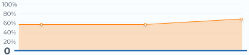 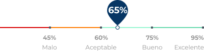 | **covered**: `kpi-engine` (alerts-dashboard-reports.md §3.4). |
| | Celo a 45-60 días postparto (2) | none | **covered**: `kpi-engine` (§3.4). |
| **Preñez** (Diagnósticos / Esperados) | Servicios realizados (2/4). The tile's label is a 2019 copy-paste bug that reads "Eficiencia detección de celo"; its dialog is Servicios realizados. | 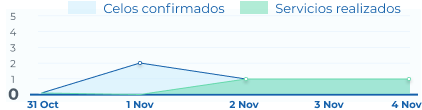 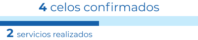 | **covered**: `kpi-engine` (§3.4, "services / confirmed heats"). |
| | Tasa de concepción de servicio (40%) | 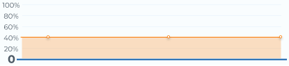 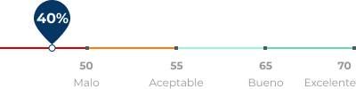 | **covered**: `kpi-engine` (§3.4 names it "Tasa de concepción **primer** servicio"; follow §3.4). |
| | Servicios por concepción (2) | 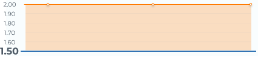 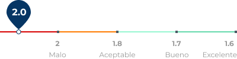 | **covered**: `kpi-engine` (§3.4). |
| **Partos** (Confirmados / Esperados) | Tiempo entre partos (467), Días/Años toggle | 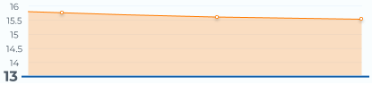 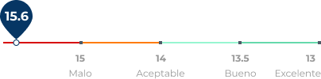 | **covered**: `kpi-engine` (§3.4; v3 toggles Meses/Días). |
| | Edad primer parto (2.3), Días/Años toggle | 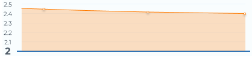 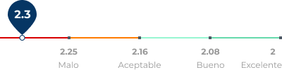 | **covered**: `kpi-engine` (§3.4; v3 toggles Meses/Años). |
| | Días entre parto y primer servicio (2) | 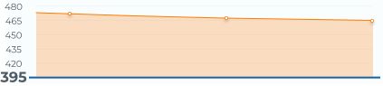 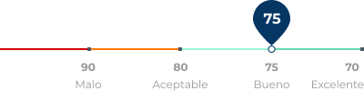 | **covered**: `kpi-engine` (§3.4, with the "Días a primer servicio" histogram). |
| **Enfermas** (Tratadas / En espera) | "Deshechadas" (2) | none | **covered**: `kpi-engine` (§3.4 "Desechadas total"; spell it **Desechadas**). |
| | "Deshechadas por fines reproductivos" (1) | none | **covered**: `kpi-engine` (§3.4 "Desechadas por problemas reproductivos"). |

The section grouping (four rows, header card with confirmed vs expected, then KPI tiles) and the chart pairs are **reference** for `reports-overview` and `reports-kpi-detail`. The Figma frames (alerts-dashboard-reports.md 1.8–1.9, and the R frames) win wherever they differ. The 2019 "Días/Años" switch is also pasted into the Eficiencia detección de celo dialog, where it means nothing; ignore it there.

Image sources (`src/assets/graphs/`, renamed to kebab-case, contents unchanged): `Graph-Deteccion de celo[-Porcentaje].png`, `Graph-Servicios Realizados[-Barra].png`, `Graph-Tasa de concepcion de servicio[-Porcentaje].png`, `Graph-Servicios por concepcion[-Barra].png`, `Graph-Tiempo entre partos[-Barra].png`, `Graph- Edad primer parto[-Barra].png`, `Graph-Dias entre parto y primer servicio[-Barra].png`.

### §3.2 Avanzado

| Card (`ResumeAdvancedCard`) | 2019 contents | Verdict |
|---|---|---|
| Finanzas | Ingresos, Egresos, Utilidad bruta, Impuestos. | **covered** as a locked tile: `reports-overview` (Avanzados render locked with the plan badge). |
| Aretes | Inventario total, Asignados, Por asignar, Con fallas. | **covered** as a locked tile: `reports-overview`. |
| Genética | "Consulta el árbol genealógico de tu hato". | **covered** as a locked tile: `reports-overview`. |

### §3.3 Export

"Descargar mi reporte" opens "¿En que formato deseas descargar tu reporte?" with XLS and PDF checkboxes (`Icon_Format_XLS.png`, `Icon_Format_PDF.png`). **covered**: `report-export`.

---

## Founder decisions (2026-11-26)

These are recorded in `docs/roadmap/dashboard.md` Approach §1–3; this section only gives each one's 2019 source. Do not re-open them here.

| Decision (`dashboard.md`) | 2019 definition |
|---|---|
| **§1 Keep the heat split.** "A revisar hoy" = first expected heat since the last calving; "Para seguimiento" = second or later cycle. Cycle length and window come from `RanchSettings`. | `heats.js`: cycles 1–6 of 21 ± 3 days from calving. `HomeFullCard.vue`: A revisar hoy = `heatCycle === 1`, Para seguimiento = `heatCycle !== 1`. |
| **§2 "Seguimiento preñez" follows confirmed pregnant cows toward calving** (GESTANTE or SECA), sorted by expected calving date. | `Home.vue` `preg()`: cows with `pregDate !== null`; the drill-down lists cows with a `pregDate`. The pregnant stock, not diagnosis follow-up. |
| **§3 Keep the "Distribución del hato" donut, web only.** Preñadas / Con servicio / Abiertas slices sum to the centre total; Enfermas is a legend line. | `Home.vue` donut with legend Preñadas / Con servicio / Abiertas / Enfermas (all `002`) and `chart.js` centre-text total. Numbers were never wired. |
